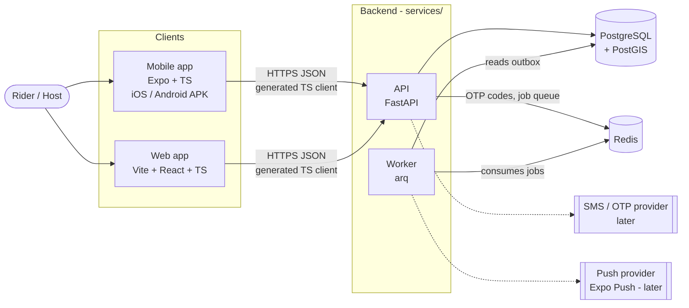
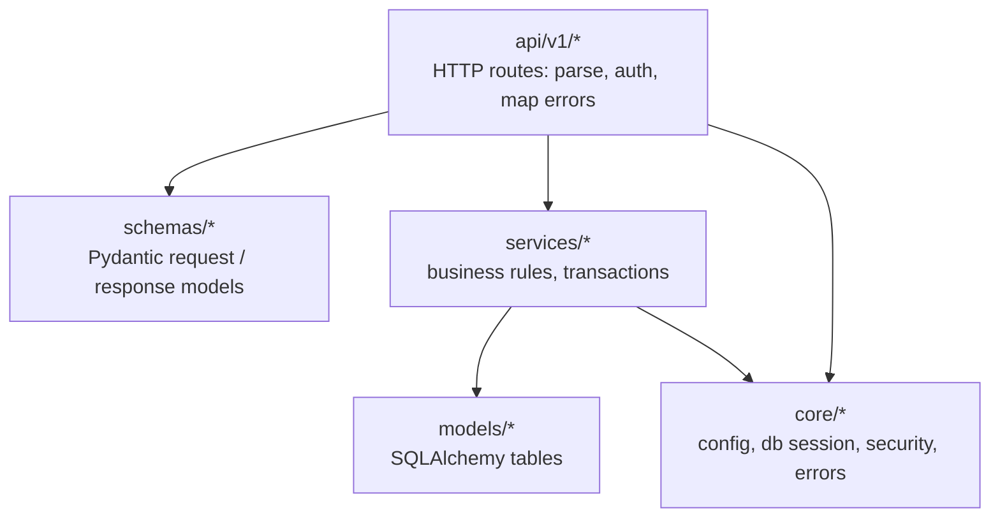
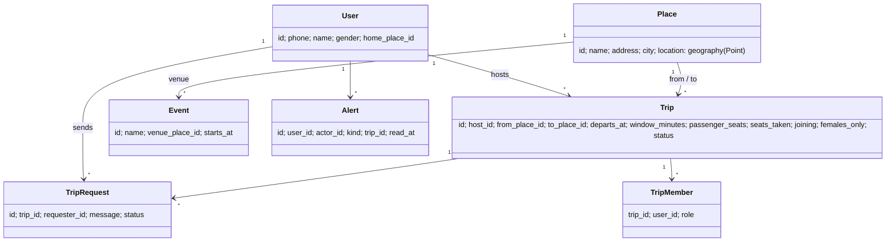

# Application architecture

Yalla is a cab trip-sharing app. A **host** posts a trip (from, to, date, a 15 or 30 minute
departure window, 1 to 3 passenger seats). Others find it, **request to join**, and the host
accepts or declines. Trips can be **Females only**. An **Events** feed (concerts and similar)
offers one-tap ride searches to and from a venue.

## System context



One backend, two thin frontends. Both frontends talk to the API through
`packages/api-client`, which is generated from the API's OpenAPI schema, so types cannot
drift between the backend and the clients.

## Containers and responsibilities

| Container | Tech | Owns |
|---|---|---|
| `services/api` | Python 3.12, FastAPI, SQLAlchemy 2 (async), Pydantic v2, Alembic | HTTP API, validation, business rules, auth, DB schema |
| `services/api` worker | arq (Redis-backed jobs), same codebase | Outbox processing: push notifications, future emails/SMS |
| PostgreSQL + PostGIS | 16 / 3.x | All durable state. Geography columns for "near this place" search |
| Redis | 7 | OTP codes (TTL), job queue, later rate limits and caching |
| `apps/web` | Vite, React, TanStack Query | Thin demo client |
| `apps/mobile` | Expo, Expo Router, TanStack Query, Zustand | Primary product client (owned by Pranav) |

## Backend layering



Rules:
- Routes never touch the ORM directly. They call a service function.
- Services own transactions and every rule from spec section 12 (seat limits, window
  limits, duplicate requests, females-only). Clients only mirror these rules for UX.
- Errors are raised as typed `DomainError`s and rendered as RFC 7807 `application/problem+json`.

## Domain model (summary)



Full column list: [`data-model.md`](data-model.md).

## Monorepo layout

```
apps/web            thin web client
apps/mobile         Expo app
services/api        FastAPI app + worker, Alembic migrations, tests
packages/api-client generated TypeScript client
infra/docker        compose files for local dev
infra/github        repo settings and rulesets as code
docs/               spec, architecture, ADRs, proposals, tracker
```

New backend services (for example a dedicated notifications service) go under
`services/<name>` with their own `pyproject.toml`, Dockerfile and CI job.

## Path to more services

The API starts as a modular monolith. Seams are drawn so a module can move out later
without touching clients:

| Module today | Could become | Seam already in place |
|---|---|---|
| `services/notifications.py` + worker | notifications service | Outbox table + Redis queue |
| `services/places.py` | places/geo service or a Places provider | Single `search_places` function |
| `services/events.py` | events ingestion service | Events only referenced by id |
| auth (`core/security.py`, `api/v1/auth.py`) | identity provider | JWT with standard claims |
