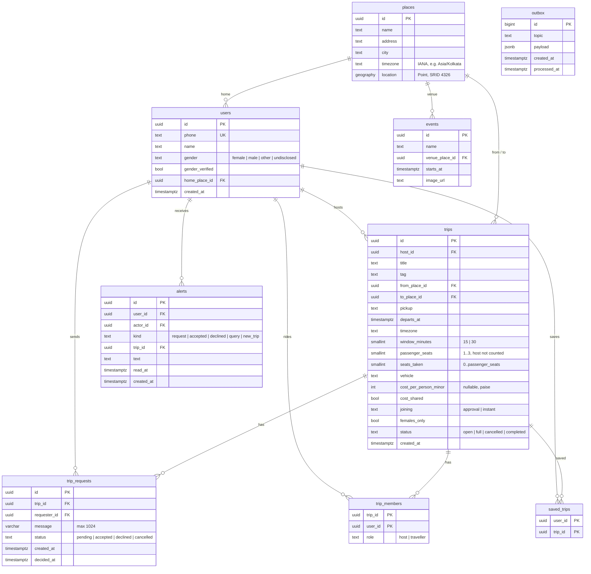

# Data model

PostgreSQL 16 with PostGIS. All ids are UUIDs. All timestamps are `timestamptz` (UTC).
Local times (a trip's departure) are stored as an instant plus the IANA timezone of the
pickup city so they render correctly anywhere.

## Constraints enforced in the database

| Rule (spec section 12) | Constraint |
|---|---|
| 1 to 3 passenger seats | `CHECK (passenger_seats BETWEEN 1 AND 3)` |
| Seats taken never exceed seats | `CHECK (seats_taken BETWEEN 0 AND passenger_seats)` |
| Window is 15 or 30 minutes | `CHECK (window_minutes IN (15, 30))` |
| Message max 1024 chars | `varchar(1024)` |
| No duplicate live request | partial unique index on `(trip_id, requester_id) WHERE status IN ('pending','accepted')` |

Rules that need context (own trip, past date, females-only) live in the service layer.

## Indexes

- `trips (status, departs_at)` for the default "upcoming open trips" listing.
- GiST on `places.location` for radius search.
- `trip_requests (requester_id, created_at desc)` and `(trip_id, status)` for the Requests tabs.
- `alerts (user_id, created_at desc)`.
- `outbox (id) WHERE processed_at IS NULL`.
