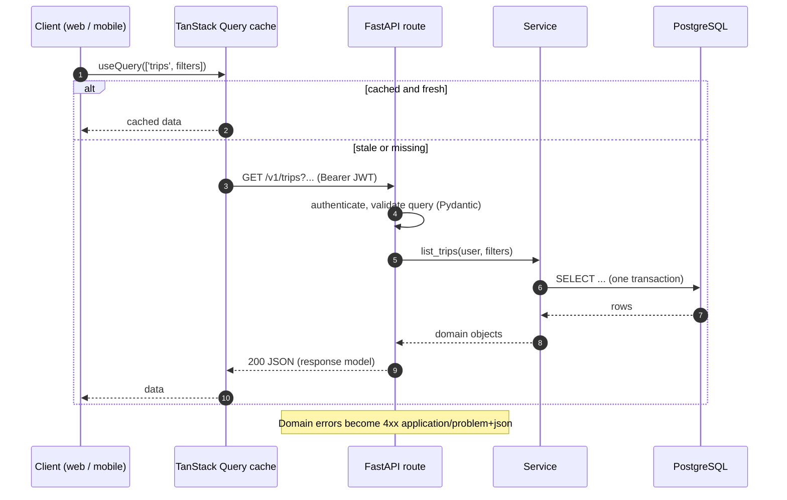
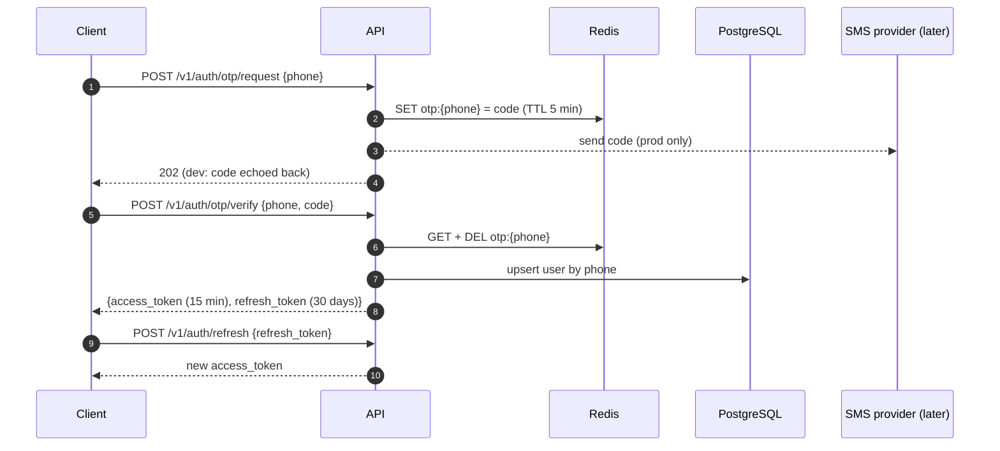
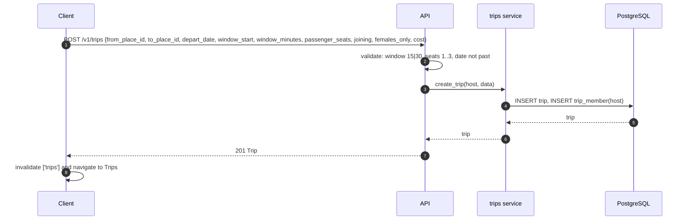
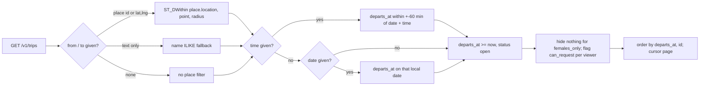
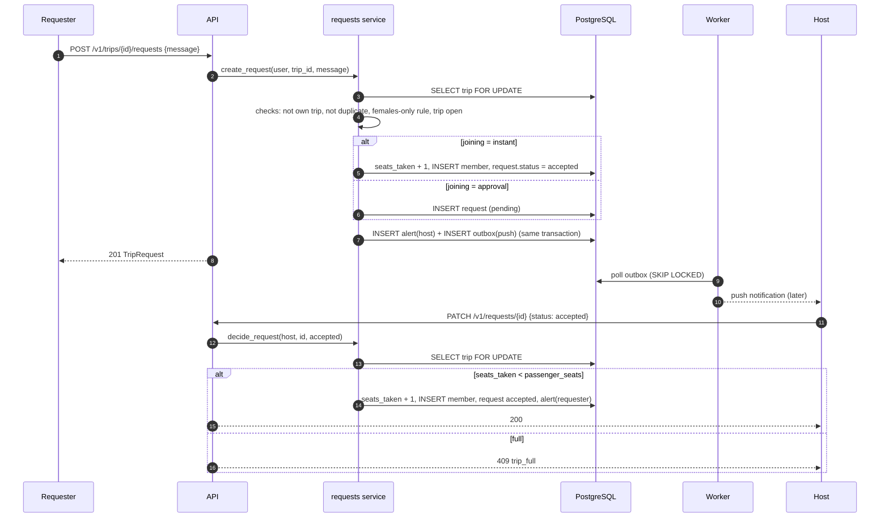
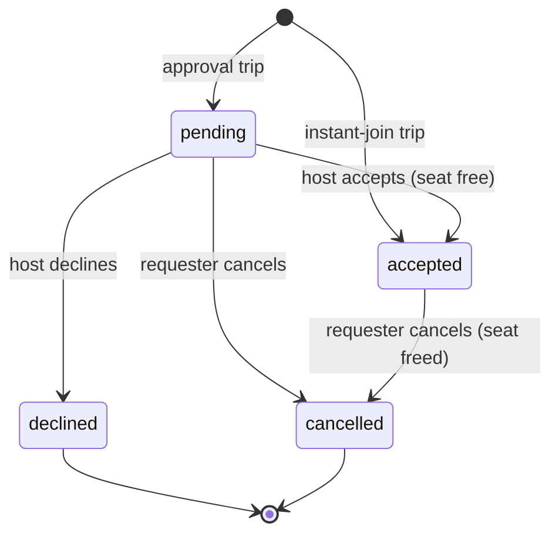
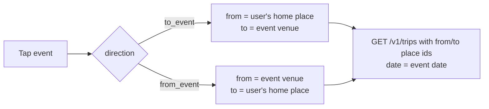
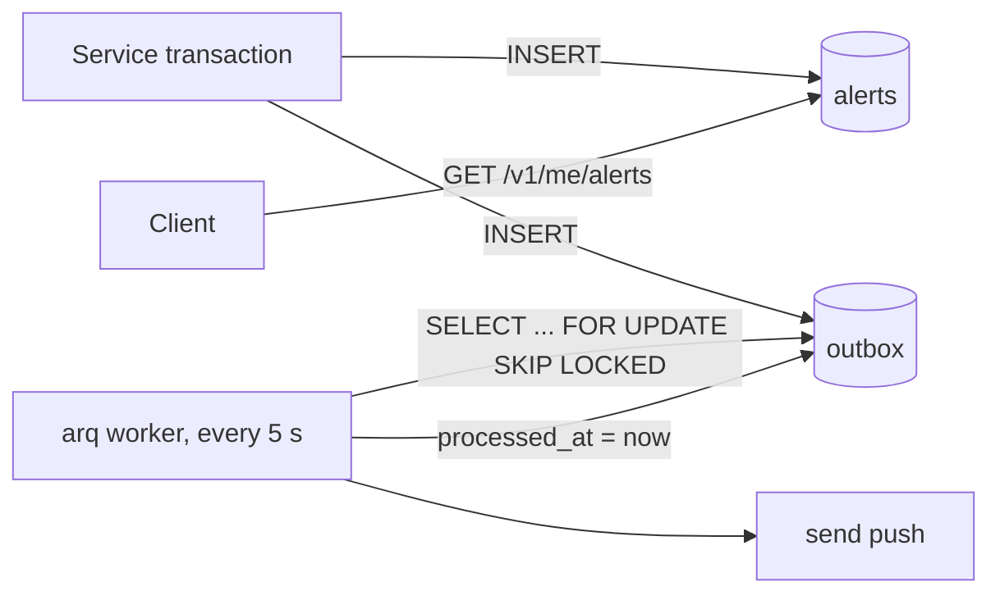

# Data flow

How data moves for each main flow, from the client tap to the database and back.
All requests go through the generated client in `packages/api-client`.

## Request lifecycle (every API call)

## Sign in (phone OTP)

## Post a trip

## Search trips

## Request to join, accept, decline

The `SELECT ... FOR UPDATE` on the trip row serialises concurrent accepts, so two hosts' taps
(or an instant join racing an accept) can never overbook the last seat.

## Request state machine

## Event ride search (Home to Event / Event to Home)

## Alerts and the outbox

Writing the alert and the outbox row in the same transaction as the business change means
an alert is never lost and never sent for a change that rolled back.
